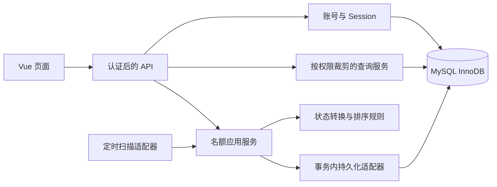
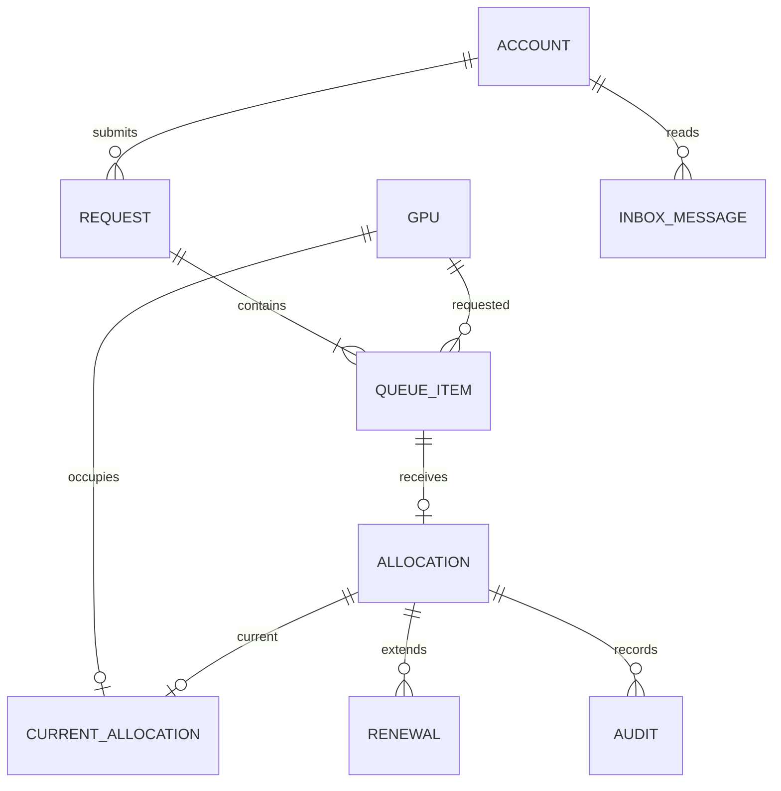

# Architecture Spine — GPU 名额排队与分配系统

## Design Paradigm

分层模块化单体：Vue 3 负责展示和提交命令；一个 Spring Boot 应用承担认证、查询与业务事务，一个本地 MySQL InnoDB 数据库保存权威状态。名额模块独占 GPU、等待项、分配、续期与调序的写入口。账号模块拥有账号和角色；通知模块拥有消息已读操作；审计记录只能追加。

依赖方向如图。Controller、扫描器和通用后台 CRUD 均不得自行修改名额表；策略层不依赖 HTTP。审计、通知的追加由应用事务调用，不启动独立事务。API 响应成功必须等待提交成功。

## Invariants & Rules

### AD-1 — 单体与模块写入边界 [ADOPTED]

- **Binds:** 全部 FR，所有 HTTP/后台入口。
- **Prevents:** 多模块各自分配、跨服务事务分裂。
- **Rule:** 使用上述模块化单体；所有影响同一卡候选排序、分配、开始、归还、续期、异常或撤销的写入经过唯一名额应用服务。成员仅操作本人名额；后台扫描使用明确的系统身份。系统不连接训练服务器、不停止进程、不测硬件占用。

### AD-2 — 固定 GPU 行锁与唯一当前名额 [ADOPTED]

- **Binds:** FR-003–014，NFR-001。
- **Prevents:** 同卡重复分配、队列变化与分配互相越过。
- **Rule:** 事务隔离统一 READ COMMITTED。先按主键锁固定 GPU 行，再读取当前名额和有效队列；新增等待项、紧急审核和调序也必须持有相关 GPU 锁。多卡命令按 gpu_id 升序取得全部相关锁，随后再访问业务记录，禁止反向取锁。current_allocation 的 gpu_id 为主键、allocation_id 唯一；每条当前映射指向同卡 allocation。它是有效名额唯一权威；未开始、已开始、异常和逾期都占用该映射。释放时在同一事务中移除映射并结束历史记录，随后可分配下一项。不能仅锁“可能不存在的当前名额行”。

### AD-3 — 不复用名额身份与幂等命令 [ADOPTED]

- **Binds:** FR-009–016，NFR-001。
- **Prevents:** 旧事件释放新名额、同人多轮获配混淆、网络重试重复副作用。
- **Rule:** 每次分配生成新的 allocation_id，归还、撤销、开始、到期与续期审批必须指向它；先验证权限，再锁 GPU，重读当前映射并校验名额身份及有效状态。不匹配或已结束只能得到失效/已处理结果，不允许仅按 gpu_id 或成员身份变更当前名额。无变化不追加业务通知或重复成功审计。请求携带 command_id，按“操作者＋command_id”唯一保存请求指纹与结果；相同键同载荷返回原结果，不同载荷报冲突。新的有意重复申请使用新键，不能按成员＋GPU 去重。

幂等优先级固定为：先验证当前操作者有权访问该命令结果，再查询已提交幂等记录；命中同载荷直接返回原结果，早于名额已结束的冲突判断。未命中才进入锁内状态转换，锁后再检查一次幂等记录。并发同键竞争唯一约束失败时，必须整体回滚后读取胜出事务结果，不继续执行部分业务；键载荷不匹配仍为冲突。

### AD-4 — 到期与续期共用串行状态转换 [ADOPTED]

- **Binds:** FR-008–012，PRD §3，NFR-001。
- **Prevents:** 旧期限覆盖新期限、续期复活已结束名额。
- **Rule:** 续期和到期均在 AD-2 锁内读取最新状态、期限及身份；以同卡成功提交事务顺序确定结果，回滚不产生成功记录。每次转换在锁内使用数据库 UTC 微秒时间并递增该卡 transition_seq，序号为顺序权威，时间相同不代表并发成功。不得用锁等待前的时间或快照裁决。批准续期将明确的新到期时间写入原名额；审批表保存该时间，不用扫描事件携带的旧期限覆盖它。批准时仍须延长当前期限；已过期但保留名额允许延长到未来。续期仅改变期限，不自动消除未开始异常。已结束则审批失效，不复活。

短时分支按锁后最新已批准expires_at与原allocated_at的总跨度判断是否不足24小时，不按原申请时长固定分类；24小时异常阈值始终为原allocated_at加24小时。D039确认6→12小时仍属短时，6→24/30小时转为满24小时异常核实分支；已存异常不因延期清除。扫描事件不拥有独立时长分类权威，未批准续期不改变当前分支。

### AD-5 — 状态、副作用与失败同事务 [ADOPTED]

- **Binds:** FR-013–016，NFR-003。
- **Prevents:** 名额变了却无审计、提交前发通知、超时重试重复分配。
- **Rule:** 业务变化、当前映射、command_id 结果、审计和站内消息同一数据库事务提交；任何必需写入失败全部回滚，包括受检异常，禁止吞掉异常后返回成功。事务入口必须真正穿过 Spring 事务代理，不能依靠同对象自调用生效。事务内无远程网络 IO、人工等待或训练操作。死锁/锁超时先整体回滚，可复用原 command_id 做有限重试；超过重试上限返回可重试失败，不宣称成功。消息唯一键用“业务转换 ID＋接收者＋消息类型”，而不是只用名额 ID，允许同一名额续期后再次逾期产生新消息。

### AD-6 — 数据库扫描恢复与队列一致排序 [ADOPTED]

- **Binds:** FR-005–008、010、015、018。
- **Prevents:** 内存定时器丢失到期任务、扫描重放副作用、空闲资源长期不分配。
- **Rule:** Spring 定时扫描及启动补查从数据库寻找候选，再逐 GPU 调用同一事务服务；候选只是提示，锁后重新判断。扫描覆盖到期、分配后 24 小时未开始及空闲有等待项的卡；不能只靠释放事件触发下一次分配。异常已标记后不重复通知，但仍可后续开始或核实处理；逾期/异常都不自动去掉当前映射。普通排序统一为等待超过 72 小时组、已批准紧急组、其余组，各组按原 submitted_at、receive_seq 排序；部分分配不重置提交时间。receive_seq 在提交入口持久化生成，同一次请求重试复用原值。查询与分配使用同一排序策略及同一评价时间，公开队列只返回姓名、顺序。

### AD-7 — 只对当前等待项生效的人工调序

- **Binds:** FR-007、013、018。
- **Prevents:** 临时干预变为永久成员特权、页面排序与获配顺序不同。
- **Rule:** 人工移动以指定 GPU 当前完整有序等待列表中的目标位置表达，锁内保存目标项及其移动后前驱/后继 ID，记录前后顺序。每次查询或分配先按 AD-6 建立基础列表，再按 transition_seq 升序逐条重放仍在排目标项的移动：若原后继仍在本卡列表，移到其紧前；否则若原前驱仍在，移到其紧后；两者均不在则本条不移动。单项列表无需移动。后继优先于前驱，不同时维护两条永久相对约束；后发生移动覆盖之前的位置，禁止拓扑约束解释。锚点不得为目标本身。目标项离队后删除其移动规则，新申请不继承；锚点离队仅按上述退化，不引用其他卡或已结束项。此为 D015“当前有效”的确定性实现细化，非新增成员优先权。

### AD-8 — Session 权限与同源部署 [ADOPTED]

- **Binds:** FR-001、015–018，NFR-002。
- **Prevents:** 前端隐藏按钮代替鉴权、公开队列泄露详情、跨站修改状态。
- **Rule:** Spring Security 负责登录 Session、口令散列和 CSRF 校验；浏览器 Cookie 为 HttpOnly，同源部署，组内正式访问使用 HTTPS 与 Secure Cookie。开发仅本机 HTTP 时允许独立配置。API 逐操作校验角色和名额归属，不能信任客户端成员 ID；查询显式投影公开字段，不返回实体全集。管理员创建账号，初始管理员通过受控初始化建立，日志不记录口令/Session。第一版单应用实例、数据库仅本机访问，无 Redis、消息队列或独立训练执行器。

## Consistency Conventions

| Concern | Convention |
| --- | --- |
| 标识 | allocation_id 不复用；request_id/queue_item_id/command_id 分开，JSON 标识用字符串，避免浏览器大整数精度问题 |
| 时间 | 数据库会话 UTC，DATETIME(6) 保存 UTC，API ISO 8601 带 Z；界面 Asia/Shanghai；天=连续24小时；判断超过72小时用严格大于 |
| 名额状态 | started_at、not_started_anomaly_at、ended_at 和 expires_at 分别表达事实；逾期由 started_at 非空且 expires_at 已过且映射仍在推导；未开始异常不因延期丢失 |
| 历史 | allocation 历史不作第二份有效性权威；结束原因 RETURNED/REVOKED/UNSTARTED_EXPIRED/VERIFIED_RELEASED，历史不自动删除 |
| 返回 | 未认证401、无权限403、状态/幂等冲突409、输入不合法400；同键成功重试返回原成功结果；合法旧自动事件返回无变化结果 |
| 持久化 | 业务表均 InnoDB，外键限制悬空映射；schema 变更用版本化迁移，禁止运行期自动改表；ORM/JDBC 不得绕过锁入口 |

## Stack

| Name | Version |
| --- | --- |
| Java | 21（用户选择；本机 JAVA_HOME 指向 JDK 21） |
| Spring Boot | 3.3.13（用户选择；本地 parent POM 已核实） |
| Vue | 3（主版本已选；精确补丁创建工程前锁定） |
| MySQL | 8.0（用户描述服务端；客户端8.0.34已实测，服务端待核实） |

版本事实、官方来源与创建工程前检查见 ADR.md。前端采用官方 create-vue；本轮未生成工程。Boot BOM 统一管理 Spring 依赖，不混用已查阅文档的其他大版本默认值。

## Structural Seed

CURRENT_ALLOCATION.gpu_id 主键；allocation_id 唯一，且与历史分配的 gpu_id 组成匹配外键。QUEUE_ITEM 每个申请中每张指定卡一条，不跨申请合并重复卡。REQUEST 提交时间与接收序号固定；审批、部分分配不改变它。申请整体状态从各等待项及名额推导，禁止维护一个可独立改写的“整单全获配”标志。

本地运行：浏览器→同源静态资源/API→单 Spring Boot 进程→本地 MySQL。开发 Vue 服务代理 API，组内部署静态构建产物和后端同源；具体静态托管器在部署故事选择。dev、test、demo 数据库和账号分离，测试禁止操作真实申请。数据库迁移由部署步骤单次执行，账号权限限定到本应用库。启动补查、进程存活、扫描失败/最后成功时间、锁超时及回滚计数必须可观察。备份与恢复演练在首次真实试用前完成，恢复后先核对当前映射和历史再补扫，不凭备份宣称硬件空闲。

## Capability → Architecture Map

| Capability / Area | Lives in | Governed by |
| --- | --- | --- |
| FR-001 | 账号/认证与受控初始化 | AD-1、8 |
| FR-002–008 | 名额模块、排序策略 | AD-1、2、6、7 |
| FR-009–012 | 名额生命周期与续期 | AD-2–6 |
| FR-013–014 | 管理员命令入口 | AD-1–5、7、8 |
| FR-015–016 | 事务内审计/通知追加、本人已读接口 | AD-3、5、8 |
| FR-017–018 | 授权查询与Vue页面 | AD-6、7、8 |
| NFR-001–003 | MySQL集成验证与权限验证 | AD-2–8；verification-plan.md |

## Deferred

- 工程创建前核实服务端 SELECT VERSION()、运行 JDK、Maven、Node、Vue/create-vue 及依赖精确版本并提交锁文件；当前不要求新下载来完成设计。
- 持久化库、schema 完整字段和迁移工具由工程基础故事选择；必须遵守 AD-2–5，不能用内存库替代 MySQL 并发验收。
- 路由、组件、API 路径和分页细节在 UX/故事阶段确定；上述身份、字段权限、错误及幂等契约不可改变。
- 扫描间隔、重试次数、锁超时和备份周期在运行故事给出配置与测试终点；不得声称尚未约定的生产实时 SLA。应用停机时不会即时释放，恢复后补查。
- Q09 公平性基线、Q10 实验 A 指标/分工按 PRD 的责任人与复核时点处理；保留实验 A，不做 B。本轮不编写代码或执行系统测试。
