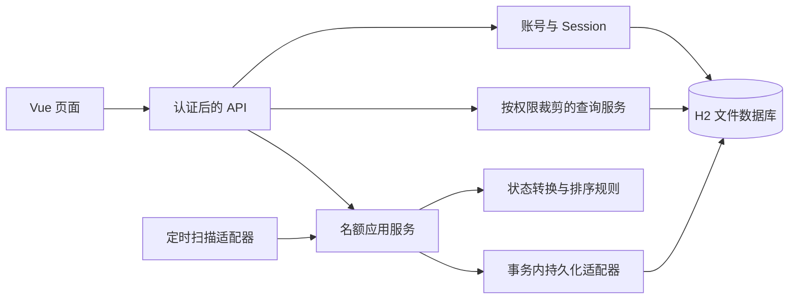
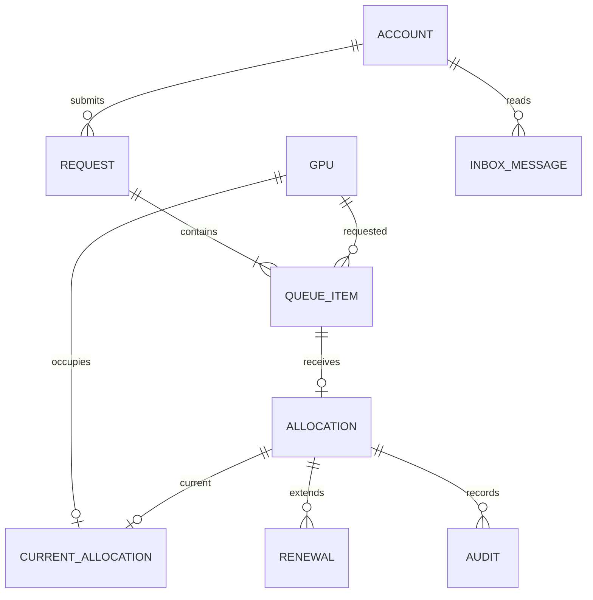

# Architecture Spine — GPU 名额排队与分配系统

## Design Paradigm

分层模块化单体。Vue 3 展示页面并提交操作，单个 Spring Boot 应用提供认证、查询和业务事务，内嵌的 H2 文件数据库保存业务状态。名额服务拥有 GPU、等待项、分配、续期与调序的写入口。账号模块拥有账号和角色，通知模块处理已读，审计只追加。

依赖方向如图。Controller、扫描器和通用后台 CRUD 均不得自行修改名额表；策略层不依赖 HTTP。审计、通知的追加由应用事务调用，不启动独立事务。API 响应成功必须等待提交成功。

## Invariants & Rules

### AD-1 — 单体与模块写入边界 [ADOPTED]

- **Binds:** 全部 FR，所有 HTTP/后台入口。
- **Prevents:** 多模块各自分配、跨服务事务分裂。
- **Rule:** 使用上述模块化单体；所有影响同一卡候选排序、分配、开始、归还、续期、异常或撤销的写入经过唯一名额应用服务。成员仅操作本人名额；后台扫描使用明确的系统身份。系统不连接训练服务器、不停止进程、不测硬件占用。

### AD-2 — 唯一当前名额 [ADOPTED]

- **Binds:** FR-003–014，NFR-001。
- **Prevents:** 同卡重复分配、队列变化与分配互相越过。
- **Rule:** 使用普通数据库事务。current_allocation 以 gpu_id 为主键，allocation_id 唯一，通过匹配外键指向同卡历史分配。当前映射是有效性的唯一权威，未开始、已开始、异常及逾期均保留映射。释放在同一事务中结束原名额、移除映射并对合法队首分配。

### AD-3 — 名额身份与重复操作 [ADOPTED]

- **Binds:** FR-009–016，NFR-001。
- **Prevents:** 旧操作误改后继、同一人多轮获配混淆、重复操作产生副作用。
- **Rule:** 每次分配生成新的 allocation_id。开始、归还、撤销、到期及续期审批按该身份操作。鉴权后读取目标和当前映射，依据最新业务状态判定。重复开始、归还、审核或标记已读返回已处理或无变化，首次状态和原时间保持。成员有意提交的重复申请作为独立申请。
### AD-4 — 到期与续期处理 [ADOPTED]

- **Binds:** FR-008–012，PRD §3，NFR-001。
- **Prevents:** 旧期限覆盖新期限、续期复活已结束名额。
- **Rule:** 使用可注入的 UTC 应用时钟。处理到期与续期时读取目标当前状态及期限。批准或直接延期的新期限须严格晚于最新期限和处理时刻。先批准时到期使用新期限，先释放时旧审批失效。已逾期但仍有效的名额可延期，未开始异常和原分配、开始事实保留。

短时分支按当前已批准 expires_at 减原 allocated_at 的总跨度判定。未开始且不足 24 小时的名额到期释放。跨度达到 24 小时，原分配满 24 小时仍未开始则标记异常并保留。D039 的 6→12 与 6→24/30 小时分别适用上述两条规则。待审或拒绝不改变期限。

### AD-5 — 状态、副作用与失败同事务 [ADOPTED]

- **Binds:** FR-013–016，NFR-003。
- **Prevents:** 名额和审计不一致、重复处理产生业务消息。
- **Rule:** 业务状态、当前映射、必需审计及站内消息同一事务提交，必需写入失败时整体回滚，包括受检异常。事务通过 Spring 事务代理生效，无远程 I/O 或人工等待。提交成功后返回成功。按业务变化生成通知，重复处理无变化时不发通知，延期后新一轮逾期可以产生新通知。

### AD-6 — 数据库扫描恢复与队列一致排序 [ADOPTED]

- **Binds:** FR-005–008、010、015、018。
- **Prevents:** 内存定时器丢失到期任务、扫描重放副作用、空闲资源长期不分配。
- **Rule:** 每 60 秒扫描并在启动时补查数据库，覆盖到期、分配满 24 小时未开始及空闲有等待项。扫描与页面写入按顺序进入同一名额服务，处理时以当前状态为准。异常/逾期状态保留当前映射。查询和分配使用同一策略及评价时间，按等待严格超过 72 小时、已批准紧急、其余项分组，各组按原 submitted_at、receive_seq 排序。部分分配不重置等待时间。公开队列只返回姓名与顺序。

### AD-7 — 只对当前等待项生效的人工调序

- **Binds:** FR-007、013、018。
- **Prevents:** 临时干预变为永久成员特权、页面排序与获配顺序不同。
- **Rule:** 人工移动以指定 GPU 当前完整有序等待列表中的目标位置表达，保存目标项及其移动后前驱/后继 ID，记录前后顺序。每次查询或分配先按 AD-6 建立基础列表，再按 移动操作记录 ID 升序逐条重放仍在排目标项的移动：若原后继仍在本卡列表，移到其紧前；否则若原前驱仍在，移到其紧后；两者均不在则本条不移动。单项列表无需移动。后继优先于前驱，不同时维护两条永久相对约束；后发生移动覆盖之前的位置，禁止拓扑约束解释。锚点不得为目标本身。目标项离队后删除其移动规则，新申请不继承；锚点离队仅按上述退化，不引用其他卡或已结束项。此为 D015“当前有效”的确定性实现细化，非新增成员优先权。

### AD-8 — Session 权限与本机同源访问 [ADOPTED]

- **Binds:** FR-001、015–018，NFR-002。
- **Prevents:** 前端隐藏按钮代替鉴权、公开队列泄露详情、跨站修改状态。
- **Rule:** 本机 HTTP 同源演示。Spring Security 负责登录 Session、口令散列和 CSRF，Session Cookie 为 HttpOnly。API 逐操作检查角色、本人归属并裁剪响应字段。管理员创建成员账号，初始管理员通过受控本地步骤建立。日志不记录口令或会话。仅运行一个应用实例，数据库随后端运行。

## Consistency Conventions

| Concern | Convention |
| --- | --- |
| 标识 | 每轮分配独立 allocation_id，request_id 与 queue_item_id 分开；JSON 标识用字符串 |
| 时间 | H2 用 TIMESTAMP WITH TIME ZONE 保存 UTC 时刻，Spring JDBC 读写 OffsetDateTime 并映射为 Java Instant；API ISO 8601 带 Z，页面 Asia/Shanghai；一天为连续 24 小时 |
| 名额状态 | started_at、not_started_anomaly_at、ended_at 和 expires_at 分别表达事实；逾期由 started_at 非空且 expires_at 已过且映射仍在推导；未开始异常不因延期丢失 |
| 历史 | allocation 历史不作第二份有效性权威；结束原因 RETURNED/REVOKED/UNSTARTED_EXPIRED/VERIFIED_RELEASED，历史不自动删除 |
| 返回 | 未认证 401、无权限 403、所见状态已变化等业务冲突 409、无效输入 400；重复或已失效的旧操作按业务状态返回 |
| 持久化 | 外键约束映射，版本化迁移由本地脚本明确执行，禁止 ORM 自动改表 |

## Stack

| Name | Version |
| --- | --- |
| Java | 21（用户选择；本机 JAVA_HOME 指向 JDK 21） |
| Spring Boot | 3.3.13（用户选择；本地 parent POM 已核实） |
| Vue | 3（主版本已选；精确补丁创建工程前锁定） |
| H2 | 内嵌文件模式，依赖精确版本在 Story 1.1 锁定 |

版本事实、官方来源与创建工程前检查见 ADR.md。前端采用官方 create-vue；本轮未生成工程。Boot BOM 统一管理 Spring 依赖，不混用已查阅文档的其他大版本默认值。

## Structural Seed

CURRENT_ALLOCATION.gpu_id 主键；allocation_id 唯一，且与历史分配的 gpu_id 组成匹配外键。QUEUE_ITEM 每个申请中每张指定卡一条，不跨申请合并重复卡。REQUEST 提交时间与接收序号固定；审批、部分分配不改变它。申请整体状态从各等待项及名额推导，禁止维护一个可独立改写的“整单全获配”标志。

本机运行路径为浏览器 → 单个 Spring Boot 进程 → 本地 H2 文件。开发时 Vue 代理 API，演示时应用提供同源页面和 API。开发和演示数据目录分离，测试使用独立临时文件库。脚本先执行版本化迁移再启动。应用停止后手动备份数据库文件，使用独立副本恢复，核对当前映射与历史后再启动补查。

## Capability → Architecture Map

| Capability / Area | Lives in | Governed by |
| --- | --- | --- |
| FR-001 | 账号/认证与受控初始化 | AD-1、8 |
| FR-002–008 | 名额模块、排序策略 | AD-1、2、6、7 |
| FR-009–012 | 名额生命周期与续期 | AD-2–6 |
| FR-013–014 | 管理员命令入口 | AD-1–5、7、8 |
| FR-015–016 | 事务内审计/通知追加、本人已读接口 | AD-3、5、8 |
| FR-017–018 | 授权查询与Vue页面 | AD-6、7、8 |
| NFR-001–003 | H2 独立文件库的顺序功能、权限、审计与一致性检查 | AD-2–8；verification-plan.md |

## Deferred

- 工程创建时核实实际运行的 JDK、Maven、Node，锁定 Vue/create-vue、H2 及新增依赖。
- Story 1.1 记录 H2 文件位置、账号表结构、持久化及迁移工具和可复现的启动步骤。
- 路由、组件、API 路径和分页细节在故事中确定，保持权限、公开字段和业务状态约定。
- Story 3.8 验证扫描配置、停机备份和独立副本恢复。停机期间没有自动释放，恢复后启动补查。
- Q09 公平性基线、Q10 实验 A 指标/分工按 PRD 的责任人与复核时点处理；保留实验 A，不做 B。本轮不编写代码或执行系统测试。
